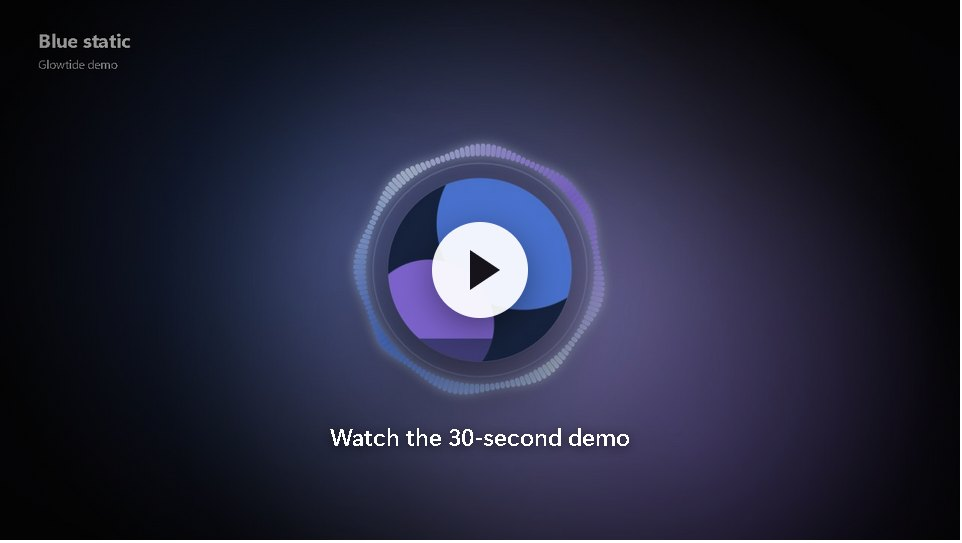

# Glowtide

**Your music, all around your screen.** Glowtide lights the edges of your screen in the colours
of the album cover and puts the lyrics on your desktop, word by word, as the song plays. It
works with **any music app** on Windows, with no setup.

### [⬇ Download the latest version](../../releases/latest)

Free · Windows 10 and 11 · Updates itself · [Source code](https://github.com/cynicalk/glowtide) (MIT)

---

## Install in a minute

1. Open the [latest release](../../releases/latest) and download **`Glowtide-<version>-setup.exe`**.
2. Open it. It installs just for you, with no administrator prompt.
3. **If Windows says "Windows protected your PC"**, click **More info → Run anyway**. The
   installer isn't code-signed yet, so Windows doesn't recognise it. That's all it means.
4. Play some music in any app: Spotify, YouTube in your browser, Apple Music, anything.

Glowtide lives in the **tray** by the clock. When an update is ready, you'll see **Restart to
update**.

## What you get

- ✨ **Edge glow:** a soft light around your screen in the colours of what's playing.
- 🎤 **Lyrics on your desktop:** timed to the music, in seven styles, from karaoke to a
  constellation drawn by the words.
- 🗣️ **Just say it:** press **Ctrl+Alt+V** and say "next song", "volume forty" or "play
  Blinding Lights". Or turn on **"Hey Glow"** for hands-free.
- 🖥️ **Full screen:** a visualizer, or the album art filling your screen (**Ctrl+Alt+F**).
- 📊 **Your listening:** stats, a weekly recap and your year in music.
- 🎛️ **Extras:** a mini player, a phone remote, quieter music during calls, and a pause when
  your headphones come out.

## Your privacy

No account, no tracking, no Glowtide server. Everything runs on your PC, including voice:
nothing you say is saved or sent anywhere.

## Need help?

See **Help** in the [main page](https://github.com/cynicalk/glowtide#help): missing lyrics,
lyrics out of sync, "Hey Glow" not hearing you, and where your settings live.

Your settings are in `%APPDATA%\Glowtide`. Uninstall from Windows Settings → Apps.

Releases before 1.0.11 keep their original installer file names.
